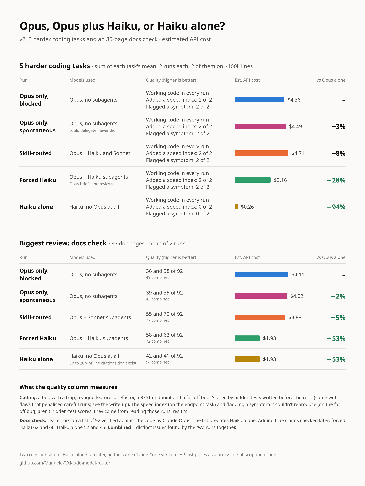

# claude-model-router

Does delegating work to cheaper models actually save money?

This repo is an experiment to find out. It has two parts:

- **A Claude Code skill** (`skills/model-router/SKILL.md`) that makes Opus the manager, handing work to cheaper subagents and logging every decision.
- **A Python checker** (`scripts/verify_models.py`) that reads Claude Code's own transcripts to prove which model actually ran and how many tokens each one used.

## The two experiments

### v1: reading code

20 tasks on three codebases, up to ~52k lines, comparing Opus alone, Opus free to delegate, my routing skill, and Opus delegating only to Haiku.

- **Small codebase:** Opus alone was the most accurate per run, and the skill cost 14-30% more for no gain.
- **~22k lines:** Opus plus Haiku matched Opus's quality at 41% less.
- **~52k lines:** Opus plus Haiku cost 75% less, but forced Opus found the most on the biggest docs check.
- **Paper estimates misled:** re-pricing delegated work at Opus rates suggested 34-85% savings, while real results ranged from 30% more expensive to 75% cheaper.

**[Read the v1.0 results and discussion](docs/v1-results.md)**

### v2: bigger code, writing code, and no Opus at all

94 runs on 10 tasks: 3 reading tasks on buildbot (~100k lines), and 7 coding tasks scored by hidden tests. It also added Haiku alone, with no Opus anywhere.

- **Coding:** every setup produced working code. On five harder tasks, Haiku alone cost 94% less than Opus alone.
- **Big reviews:** on an 85-page docs check, Opus plus Haiku cost half as much as Opus alone and found over 60% more real errors. It also found about 30% more than Haiku alone at the same price.
- **What Opus adds is care:** all 8 Opus-led runs added a speed index when asked for speed and flagged a symptom they couldn't reproduce. Neither Haiku-alone run did either.
- **My routing skill rarely paid off**, and left alone, Opus never delegated.

**[Read the v2.0 results and discussion](docs/v2-results.md)**

## What I'd use today

| What you're doing | What I'd use | Why |
| --- | --- | --- |
| A small, testable coding task you'll review yourself | **Haiku alone** | 1-12% of Opus alone's cost on five harder coding tasks, with working code in every run |
| Coding where care matters | **Opus delegating to Haiku** | 28% cheaper than Opus alone on those tasks, and Opus reviews the work |
| A big review or audit | **Opus delegating to Haiku** | Half the cost of Opus alone on an 85-page docs check, with over 60% more real errors found |

<p align="center">
  
</p>

**Treat these as strong hints, not proof.** Most setups ran twice per task, costs are API prices used as a proxy for subscription usage, and Claude Opus wrote my hidden tests and verified the errors. Two of those tests had flaws, reported in the results. No coding task made Haiku alone fail, so I don't know where its limit is. Test on your own work.

**Takeaway: cheaper tokens don't necessarily mean cheaper tasks, and the most expensive model isn't always the one doing the useful work. Measure the whole workflow.**

## Setup

Requires Claude Code 2.1.305 or later, Python 3.8+, and `CLAUDE_CODE_SUBAGENT_MODEL` unset.

```bash
ln -s ~/Documents/Coding/claude-model-router/skills/model-router ~/.claude/skills/model-router
python3 scripts/verify_models.py --since 2026-10-25
```

Start a prompt with `Use the model-router skill.` to trigger it, or `no routing.` to turn it off. Per-run numbers are in [`data/results.md`](data/results.md).

## Credits

The routing skill's design (default to Haiku, escalate only with a reason, a routing log, user overrides) follows [Maleko91/claude-code-adaptive-subagents](https://github.com/Maleko91/claude-code-adaptive-subagents), which reports 3-15x token savings. The `SKILL.md` here was written separately. What this repo adds is the checker, which verifies which model actually ran, and the head-to-head comparison against forced Opus.

## License

[MIT](LICENSE). Use, modify and share it freely; keep the copyright notice so the credit stays with the work.
