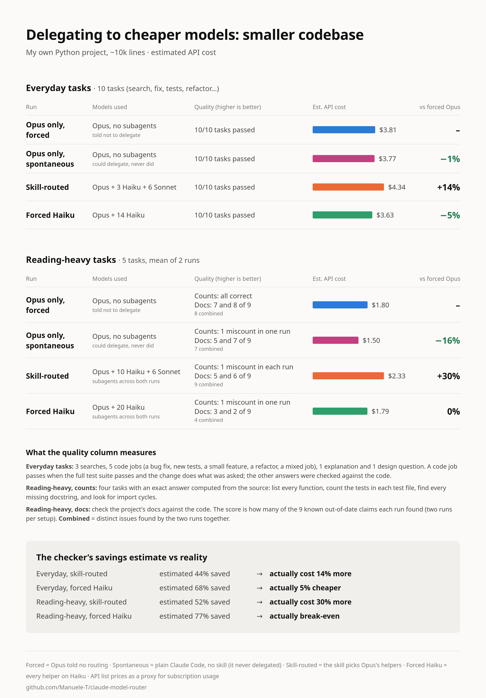
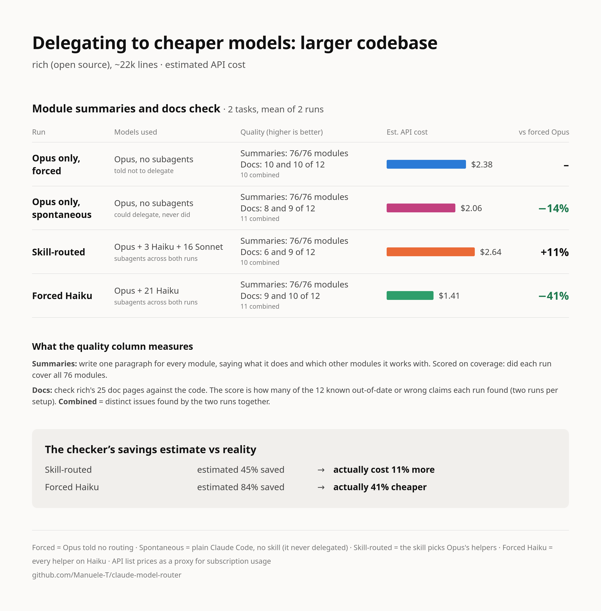
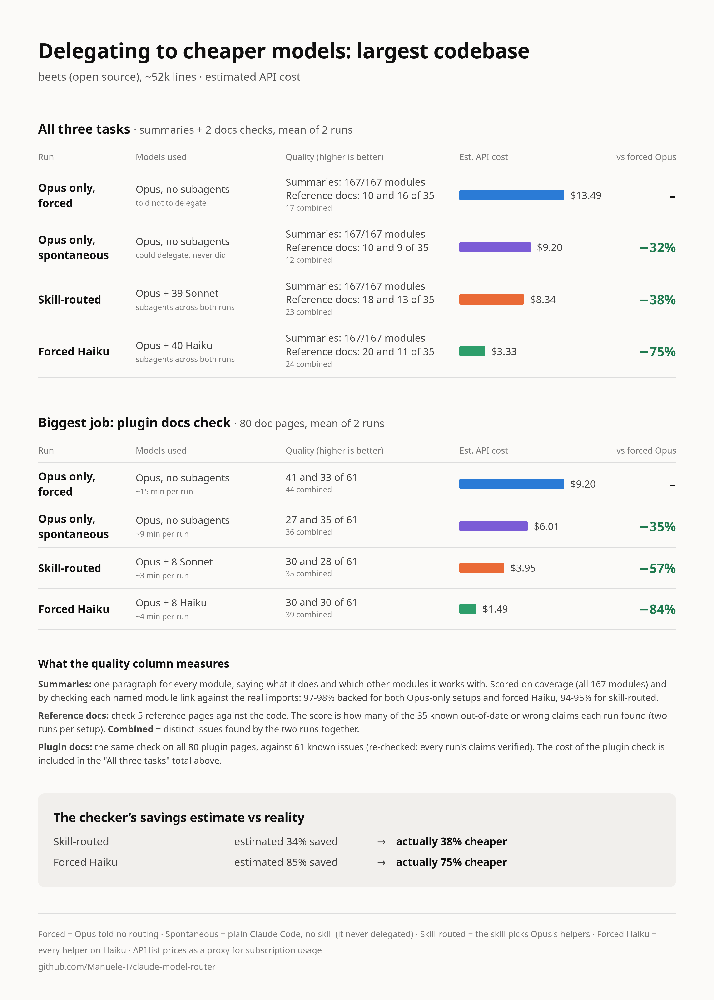

# claude-model-router

Does delegating work to cheaper models actually save money?

This repo is an experiment to find out. It contains two things:

- **A Claude Code skill** (`skills/model-router/SKILL.md`) that makes Opus the manager. Opus splits the work and hands pieces to cheaper subagents: Haiku by default for finding, listing and counting, Sonnet for anything that needs understanding the code, and Opus itself for hard design or security reasoning. Tiny tasks stay with Opus. Every decision is logged.
- **A Python checker** (`scripts/verify_models.py`) that reads Claude Code's own transcripts to prove which model actually ran and how many tokens each one used.

**How the test works.** I ran 20 tasks across three codebases (~10k, ~22k and ~52k lines). Every task was run four ways, and the cost and quality compared:

1. **Opus only, forced** ("forced Opus" below): Opus is told `no routing.`, so it does everything itself. In the later beets runs the Agent tool was also blocked, so it couldn't spawn subagents at all.
2. **Opus only, spontaneous** ("spontaneous Opus"): plain Claude Code on Opus, no skill. Opus may spawn subagents and decides by itself whether to. It never did.
3. **Skill-routed:** Opus uses the skill and chooses which model each subagent runs on.
4. **Forced Haiku:** Opus uses the skill, but every subagent must run on Haiku. Opus still plans, briefs and checks the work.

**Scope:** almost all tasks were about reading and reviewing existing code (searches, inventories, module summaries, checking docs against code), plus a few small edits. Building new code from scratch wasn't tested, so these results don't cover it.

## At a glance

I wanted to see whether, and how, Claude Opus decides to spawn subagents, and whether pushing it one way or the other (no subagents at all, only Haiku subagents, or the subagents my skill picks) changes the results. The short version, per codebase:

**Smaller codebase (~10k lines): let Opus work alone.** Forced Opus was the most accurate per run. Skill routing cost 14-30% more for no gain; forced Haiku broke even but had the weakest docs check (4 of 9 issues combined, against 8 for forced Opus). Spontaneous Opus matched forced Opus at 1-16% less.

<p align="center">
  
</p>

**Larger codebase (rich, ~22k lines): forced Haiku was the best value.** Same quality as forced Opus (11 of 12 doc issues combined, against 10) at 41% less. Skill routing sent most work to Sonnet and cost 11% more.

<p align="center">
  
</p>

**Largest codebase (beets, ~52k lines): delegation finally paid.** Forced Opus worked hardest and found the most on the 80-page docs check (44 of 61 issues combined after a re-check, against 35-39 for the others; first scored as 45 of 51 against 30-34), but one long session cost $9 per run. Forced Haiku cost 75% less overall and found the most on the reference docs (24 of 35 combined, against 17); skill routing cost 38% less.

<p align="center">
  
</p>

Across all three:

- **Left alone, Opus never delegated**, not even on 80 pages. It cost 1-32% less than forced Opus because it put in less effort, and on beets it found clearly fewer issues.
- **Sonnet helpers barely save**: their cached-context reads cost the same as Opus's, and the skill sent most comprehension work to Sonnet.
- **The obvious savings estimate was misleading.** Re-pricing delegated tokens at Opus rates suggested 34-85% savings; head-to-head, results ranged from 30% more expensive to 75% cheaper. Delegation adds briefing, duplicated reading and re-checking, which only pays off once the job is big enough to split.

**Takeaway: cheaper tokens don't necessarily mean cheaper tasks. Measure the whole workflow, not just the price of each model.**

The full write-up follows. v1 as first published is tagged [`v1.0`](https://github.com/Manuele-T/claude-model-router/tree/v1.0).

## v2 (in progress): ~100k-line codebase

v2 adds a fourth, bigger codebase, [buildbot](https://github.com/buildbot/buildbot) (408 modules, ~91k lines), with the same three task types as beets. Two changes make it stricter than v1:

- **A neutral baseline.** "Opus only, blocked" gets no prompt prefix; the Agent and Skill tools are blocked, so it can't delegate and isn't told anything. v1's forced Opus was told `no routing.`, which turned out to change how hard it worked.
- **Planted errors.** Before any run, 30 wrong claims were planted in the doc pages (wrong defaults, renamed parameters), so recall on them is true recall. Real errors found by the runs were verified against the code and counted separately.

Each setup ran twice (three times where results were far apart), with the same v1 skill:

| | Opus only, blocked | Opus only, spontaneous | Skill-routed | Forced Haiku |
| --- | --- | --- | --- | --- |
| Estimated cost, all three tasks, mean per run | $8.98 | $8.26 (-8%) | $10.19 (+13%) | $4.44 (-51%) |
| Module summaries: modules covered | all | all | all | all |
| Planted doc errors found (of 30) | 30, 30 | 30, 30 | 30, 30 | 30, 30 |
| Real doc errors, 2-page check (of 42 verified) | 10 and 17 (22 combined) | 9 and 9 (12 combined) | 17 and 21 (26 combined) | 20 and 23 (28 combined) |
| Real doc errors, 85-page check (of 92 verified) | 36 and 38 (49 combined) | 39 and 35 (43 combined) | 55 and 70 (77 combined) | 58 and 63 (72 combined) |
| Subagents | 0 | 0 | 4-10 per task, all Sonnet | 4-12 per task, all Haiku |

- **Forced Haiku halved the cost on every task and found more than Opus alone on both doc checks.** This reverses beets, where Opus alone was the most thorough on the biggest check. At this size, a single Opus session covers less than several parallel readers whose findings Opus then re-checks.
- **The skill still sent everything to Sonnet.** It was the most thorough on the 85-page check, but it saved at most 5% and cost 13% more overall.
- **Left alone, Opus still never delegated** (0 subagents in 7 runs) and cost about the same as blocked Opus.
- **Every run caught every planted error**, so they were too easy; the real errors are what separate the setups.

Same caveats as v1: costs are an API-price proxy, there are only 2-3 runs per setup, and "of 42/92" counts errors found by any run, not true recall. Per-run numbers and the scoring rules are in [`data/results.md`](data/results.md). Still to come: tasks that build new code rather than read it.

## How it works

- **Three tiers.** `skills/model-router/SKILL.md` tells the orchestrator to default to Haiku for finding, listing and formatting, to use Sonnet for anything that reads code and makes a judgement, and to keep hard design or security reasoning on Opus itself. Tiny tasks stay inline. A failed Haiku result is retried once on Sonnet.
- **Log, then verify.** Before every subagent call the orchestrator appends a line to `~/.claude/model-router/routing.log`. Afterwards, `scripts/verify_models.py` pairs every Agent call in `~/.claude/projects/**/*.jsonl` with its subagent transcript, flags any subagent that ran a different model than requested (`MISMATCH`) or switched mid-run (`FALLBACK`), and totals tokens and estimated cost per model.

## The experiment

Each task ran in a fresh clone of the project, headless (`claude -p`), with an Opus 5.5 orchestrator at effort medium:

- **Opus only, forced (A):** the prompt starts with `no routing.`, so Opus does everything itself. From the beets module summaries on, the Agent tool was also blocked.
- **Opus only, spontaneous (D):** the prompt is unchanged and subagents are allowed; only the Skill tool is blocked, so the installed router skill can't load itself.
- **Skill-routed (B):** the prompt starts with `Use the model-router skill.`
- **Forced Haiku (C):** the prompt starts with `Use the model-router skill. use haiku.`, so every subagent runs on Haiku.

Cost is estimated from the token counts in the transcripts at API list prices (Haiku 5.5, Sonnet 5.5, Opus 5.5, including Haiku's 5x rate on prompts over 100K tokens), as a stand-in for subscription usage. Percentages are each setup's cost relative to forced Opus, computed from unrounded costs. Per-task numbers are in [`data/results.md`](data/results.md), prompts in [`data/tasks.md`](data/tasks.md), [`data/tasks-v2.md`](data/tasks-v2.md), [`data/tasks-v3.md`](data/tasks-v3.md) and [`data/tasks-v4.md`](data/tasks-v4.md).

**Reading the doc-check scores:** each setup ran twice, so a score like "7 and 8 of 9" is each run's count of the known doc problems it found (higher is better). "Combined" is the number of distinct problems the two runs found together.

### Smaller codebase: my own Python project (~10k lines)

#### Everyday tasks

10 tasks: 3 searches, 5 code jobs, 1 explanation and 1 design question.

| | Opus only, forced | Opus only, spontaneous | Skill-routed | Forced Haiku |
| --- | --- | --- | --- | --- |
| Tasks passed | 10/10 | 10/10 | 10/10 | 10/10 |
| Estimated cost | $3.81 | $3.77 (-1%) | $4.34 (+14%) | $3.63 (-5%) |
| Wall time | 776 s | 850 s (+10%) | 1186 s (+53%) | 1615 s (+108%) |
| Subagents | 0 | 0 | 9 (3 Haiku, 6 Sonnet) | 14 Haiku |
| Model mismatches | - | - | 0 | 0 |

Spontaneous Opus did every task itself and matched forced Opus on cost and quality. Only one task came out cheaper in the skill-routed run (a mixed code job, by 17%). The orchestrator picked Haiku for the three lookup tasks, but the briefing and checking overhead still outweighed the cheaper tokens. Forced Haiku came out 5% cheaper overall: it lost on the small lookups and won on the bigger code jobs.

#### Reading-heavy tasks

5 tasks that should favour routing: inventory every function, map tests to modules, find every missing docstring, map imports, and check the docs against the code. Each arm ran twice. Answers were scored against ground truth computed from the source code, or, for the docs check, against a list of 9 real out-of-date doc claims.

| | Opus only, forced | Opus only, spontaneous | Skill-routed | Forced Haiku |
| --- | --- | --- | --- | --- |
| Accuracy | all correct on the first four; docs check found 7 and 8 of 9 issues (8 combined) | one miscount in one run; docs check found 5 and 7 of 9 issues (7 combined) | the same miscount in both runs; docs check found 5 and 6 of 9 issues (9 combined) | one miscount in one run; docs check found 3 and 2 of 9 issues (4 combined) |
| Estimated cost, mean per run | $1.80 | $1.50 (-16%) | $2.33 (+30%) | $1.79 (0%) |
| Wall time, both runs | 662 s | 584 s (-12%) | 1222 s (+85%) | 1324 s (+100%) |
| Runs that delegated | 0 of 10 | 0 of 10 | 10 of 10 (mostly Haiku) | 10 of 10 |

Every skill-routed run delegated, mostly to Haiku, and every task cost more than doing it on Opus alone. Forced Opus mostly didn't read file by file: it wrote a short `ast` or grep script and answered from the output, which is cheaper than briefing any subagent. Forced Haiku broke even too, but its docs check was the weakest of any arm. Spontaneous Opus did the same as forced Opus, scripts included, in shorter sessions: 16% cheaper, with a slightly weaker docs check.

### Larger codebase: rich (~22k lines)

2 tasks on [rich](https://github.com/Textualize/rich) (76 modules, about 22,000 lines of hand-written code, 25 doc pages), chosen because a script can't answer them: summarise every module, and check every doc page's API claims against the code. Each arm ran twice.

| | Opus only, forced | Opus only, spontaneous | Skill-routed | Forced Haiku |
| --- | --- | --- | --- | --- |
| Module summaries | all modules covered, ~3.5k words | all modules covered, ~3k words | all modules covered, ~5-6k words | all modules covered, ~6k words |
| Doc issues found (of 12 verified) | 10 and 10 (10 combined) | 8 and 9 (11 combined) | 6 and 9 (10 combined) | 9 and 10 (11 combined) |
| Estimated cost, mean per run | $2.38 | $2.06 (-14%) | $2.64 (+11%) | $1.41 (-41%) |
| Wall time, both runs | 806 s | 742 s (-8%) | 655 s (-19%) | not comparable* |
| Subagents | 0 | 0 | 19 (3 Haiku, 16 Sonnet) | 21 Haiku |

\* One forced-Haiku run finished early, then kept its session open about 25 minutes on a timer Opus set in case an agent hung.

Spontaneous Opus still worked alone, 14% cheaper than forced Opus with similar quality. With the skill, routing worked as designed: every skill-routed run split the reading across 4-5 parallel subagents and finished faster. It still cost 11% more overall: the summaries cost nearly twice as much as on Opus alone, while the docs check came out 22% cheaper. The orchestrator sent most batches to Sonnet rather than Haiku, because summarising or checking code needs comprehension, then checked their work itself. Forced Opus found a few more doc problems. Forced Haiku was the surprise here: 41% cheaper than forced Opus, with a docs check almost as thorough.

### Largest codebase: beets (~52k lines)

3 tasks on [beets](https://github.com/beetbox/beets) (167 modules, about 52,000 lines, far less famous than rich): summarise every module, check the 5 reference doc pages against the code, and check all 80 plugin doc pages against the code. All four setups, each run twice.

| | Opus only, forced | Opus only, spontaneous | Skill-routed | Forced Haiku |
| --- | --- | --- | --- | --- |
| Module summaries | $1.43 | $1.00 (-30%) | $2.31 (+62%) | $0.79 (-45%) |
| Reference docs check | $2.86 | $2.19 (-23%) | $2.09 (-27%) | $1.06 (-63%) |
| Plugin docs check (80 pages) | $9.20 | $6.01 (-35%) | $3.95 (-57%) | $1.49 (-84%) |
| **All three, mean per run** | **$13.49** | **$9.20 (-32%)** | **$8.34 (-38%)** | **$3.33 (-75%)** |
| Reference doc issues found (of 35 verified) | 10 and 16 (17 combined) | 10 and 9 (12 combined) | 18 and 13 (23 combined) | 20 and 11 (24 combined) |
| Plugin doc issues found (of 61 verified, re-checked*) | 41 and 33 (44 combined) | 27 and 35 (36 combined) | 30 and 28 (35 combined) | 30 and 30 (39 combined) |
| Plugin docs check, wall time per run | ~15 min | ~9 min | ~3 min | ~4 min |
| Subagents | 0 | 0 | 39, all Sonnet | 40, all Haiku |

\* First scored against 51 issues (38 and 34, 24 and 29, 27 and 27, 26 and 29). A reader pointed out that about 24 single-run or borderline claims, mostly from a Haiku run, had never been verified, so every claim from all 8 runs was re-checked against the code (details in [`data/results.md`](data/results.md)). Haiku gained the most; the order didn't change.

This is the first codebase where skill routing saved money. On the plugin docs, Opus alone had to read 80 pages in one long session; the delegated setups split them across 8 parallel subagents and finished in a quarter of the time. The cost was thoroughness: per run, both found roughly 10-30% fewer real problems than forced Opus. On the summaries and the reference docs, quality was level across the forced Opus and delegated setups.

Spontaneous Opus still didn't delegate, even on 80 pages. It cost 32% less than forced Opus because its sessions were shorter, and it found less for the same reason: on the plugin docs, about as many issues as the delegated setups (36 combined, against 44), at four times forced Haiku's cost.

Left to choose, the orchestrator sent every batch to Sonnet. Forcing Haiku is what produced the big savings, at 75% less than forced Opus overall.

## Why the savings estimate was wrong

The checker can also report a "saving vs forced Opus": it takes the skill-routed runs' tokens and asks what they would have cost if every token had been billed at Opus prices. On the everyday tasks (10 tasks, skill-routed run):

- That skill-routed run's tokens cost **$4.34** at their real models' prices.
- The same tokens billed at Opus prices would have cost **$7.69**, which suggests a **44% saving**.
- But running the same 10 tasks on Opus alone cost **$3.81**. Routing actually cost **14% more**.

The estimate assumes Opus would need the same tokens as the delegated workflow. It doesn't: on its own, Opus skips the briefs, the duplicated reading and the re-checking. The estimate overstated the saving on every set but one:

| Task set | Checker's estimated saving | Real result vs forced Opus |
| --- | --- | --- |
| Everyday tasks, skill-routed | 44% | 14% more expensive |
| Everyday tasks, forced Haiku | 68% | 5% cheaper |
| Reading-heavy tasks, skill-routed | 52% | 30% more expensive |
| Reading-heavy tasks, forced Haiku | 77% | break-even |
| rich, skill-routed | 45% | 11% more expensive |
| rich, forced Haiku | 84% | 41% cheaper |
| beets, skill-routed | 34% | 38% cheaper |
| beets, forced Haiku | 85% | 75% cheaper |

Only a head-to-head comparison measures the real effect. (Spontaneous Opus used no subagents, so the checker has nothing to re-price for it.)

## Why skill routing cost more on the smaller codebases

Opus 5.5 is not cheaper per token: it costs 2x Sonnet 5.5 and 40x Haiku 5.5. On my project and on rich, the forced Opus runs were cheaper than the skill-routed ones because they used fewer tokens in total. Forced Haiku only got ahead because Haiku's tokens cost a fortieth of Opus's, enough to absorb the same overheads:

- **No duplicated reading.** A subagent starts with an empty context and reads the files itself. Opus then reads its output and re-checks the important parts, so the same code is paid for on two models.
- **No coordination overhead.** Loading the skill, writing a brief for each subagent and logging each decision all cost Opus tokens. On the rich module summaries, the coordinating Opus alone cost about as much as a whole forced Opus run ($0.83 and $0.58, against $0.88 and $0.50).
- **Caching favours one long session.** Opus re-reads its own cached context cheaply ($0.20 per million tokens), while each new subagent has to build its own cache first, and cache writes cost 1.25x the input price.
- **Opus took shortcuts**, like the scripts above.

In some runs the cheaper models also used more tokens for their part of the work than Opus needed for the whole job: on the rich module summaries, the subagents wrote 30k and 52k output tokens, against 15-19k for an entire forced Opus run. My hypothesis is that Opus often solves these tasks with fewer total tokens, while delegation adds coordination and verification costs. The experiment supports this, but it doesn't separate the effect of model capability from workflow overhead.

**Why forced Opus cost more than spontaneous Opus.** Both are Opus working alone on the same Claude Code version, yet forced Opus cost more on every task set and, on the 80-page beets check, found more (41 and 33 of 61 issues after the re-check, against 27 and 35; 44 against 36 combined). The transcripts show it put in more effort: every forced run produced more output, thinking included, than every spontaneous run on the same task (beets reference docs: 22-27k output tokens per run against 17-22k; plugin docs: 44-50k against 31-34k). On the plugin docs it worked one plugin at a time, reading each page and then that plugin's code, while one spontaneous run read 5-10 pages per command and thought about a third as much. Each extra turn also re-reads the whole context, so the extra effort costs more than its own tokens. The thinking itself is encrypted in the transcripts, so why it works harder is a guess. What every forced run had in common was the `no routing.` instruction with the router skill visible in its tool list (most forced runs could still have spawned subagents; only the later beets runs blocked them). Being told not to delegate seems to make Opus plan to cover everything itself. In a follow-up, the instruction without the skill visible, and blocking subagents without the instruction, both landed in between. With 2-4 runs per setup, the size of the effect is uncertain: forced Opus on its own found anywhere from 10 to 16 of 35 issues on the same task (details in [`data/results.md`](data/results.md)).

**Why it paid on beets.** On the 80-page plugin docs check, Opus alone ran one session of about 150 turns and re-read roughly 32 million cached tokens, so even cheap cache reads added up to $9 per run. The delegated runs split the pages across 8 subagents with small contexts each; the coordinating Opus cost about $1. Once the job is that big, the overhead of briefing and checking is small next to the reading it saves.

## What still works

Routing is mechanically sound: across all runs, every subagent ran the model it was asked for (0 mismatches, 0 fallbacks), and the checker can prove it. That check is worth having on its own, because a single setting (`CLAUDE_CODE_SUBAGENT_MODEL`) silently overrides every subagent's model.

Routing choices were not stable, though. With identical prompts, routes often changed between runs (Haiku in one run, Sonnet in the next), and the skill-routed arm's total cost varied by up to 68% between two runs of the same task set.

## Limitations

- 20 tasks on three codebases is a small sample.
- The smallest codebase is a private throwaway project of mine, so its results can't be rerun by others. The rich and beets sets can be rerun.
- Costs use API list prices as a proxy for subscription usage; Anthropic doesn't publish the exact subscription weighting.
- On the everyday task set, each arm ran once; the other sets ran each arm twice.
- Opus alone varies a lot from run to run (forced Opus found 10 to 16 of 35 issues on the same task), so the gap between forced and spontaneous Opus is consistent in direction but uncertain in size.
- Doc-check scores count issues verified against the code by Claude Opus in a separate session, not by hand. On the smaller doc checks, borderline claims (mostly from the Haiku runs) are left out; the 80-page beets check was re-scored with every claim from every run verified, borderline ones counted, and about 20 unverifiable claims left out.
- rich is a famous library, and Opus said part of one summary came from its own knowledge of it. That favours the forced Opus arm. beets is much less famous, though one forced Opus run still named two module paths that no longer exist, which suggests it was working from memory.

## Setup

Requires Claude Code 2.1.305 or later (earlier versions could run the wrong model after a fallback), Python 3.8+, and `CLAUDE_CODE_SUBAGENT_MODEL` unset.

```bash
ln -s ~/Documents/Coding/claude-model-router/skills/model-router ~/.claude/skills/model-router
python3 scripts/verify_models.py --since 2026-10-25
```

Start a prompt with `Use the model-router skill.` to trigger it, or `no routing.` to turn it off.

To rerun a benchmark task: `scripts/run_bench.sh <task> <A|B|C|D|F> [tag]` runs one row of `data/tasks.md` headless in a fresh clone of the bench project. Arm A also blocks the Agent tool, so a delegation rule in a global `CLAUDE.md` can't leak subagents into the forced Opus runs; arm D blocks the Skill tool instead, so the installed router skill can't turn a spontaneous run into a skill-routed one. Set `TASKS=data/tasks-v2.md`, `TASKS=data/tasks-v3.md` (with `SRC` pointing at a rich checkout), `TASKS=data/tasks-v4.md` (with `SRC` pointing at a beets checkout) or `TASKS=data/tasks-v5.md` (with `SRC` pointing at a buildbot checkout) for the other task sets. Arm F (the v2 baseline) blocks both tools and adds no prefix.

## Credits

The routing skill's design (default to Haiku, escalate only with a reason, a routing log, user overrides) follows [Maleko91/claude-code-adaptive-subagents](https://github.com/Maleko91/claude-code-adaptive-subagents), which reports 3-15x token savings. The `SKILL.md` here was written separately. What this repo adds is the checker, which verifies which model actually ran, and the head-to-head comparison against forced Opus.

## License

[MIT](LICENSE). Use, modify and share it freely; keep the copyright notice so the credit stays with the work.
