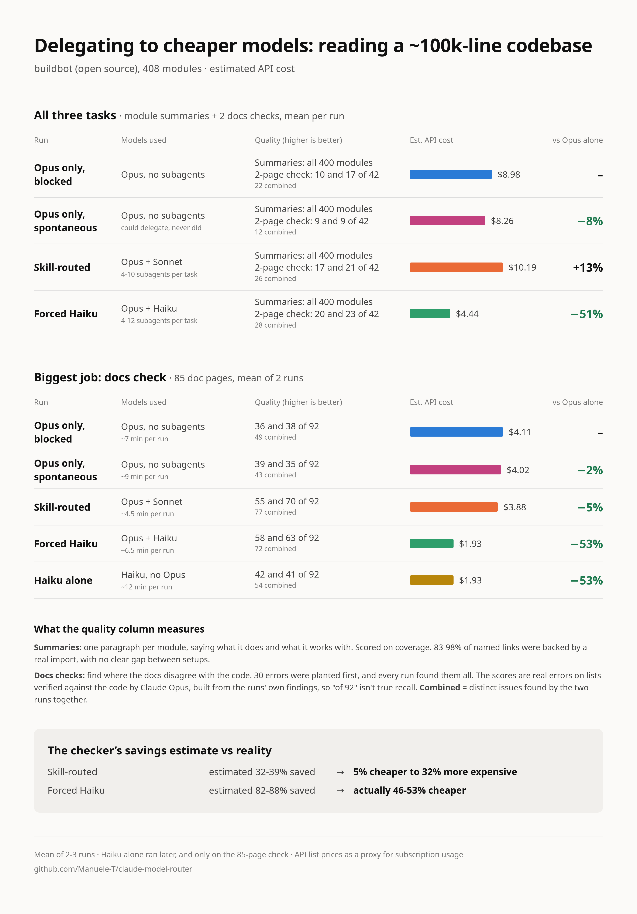
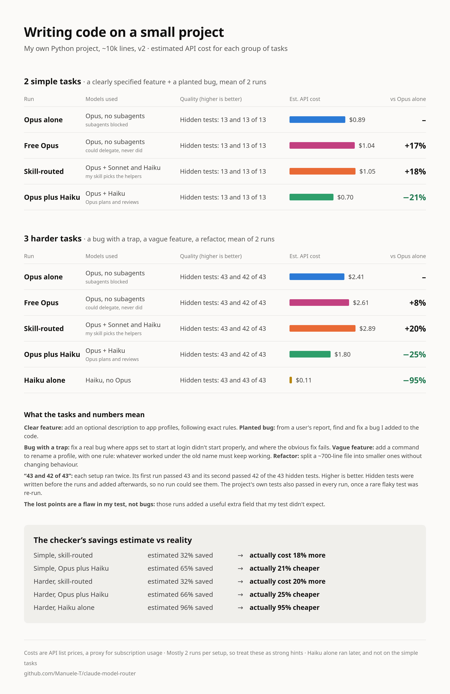
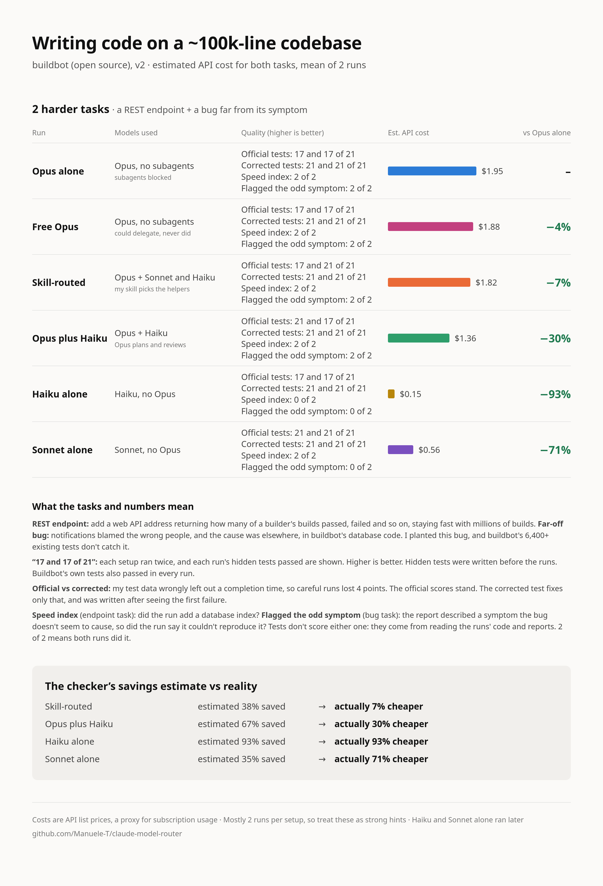
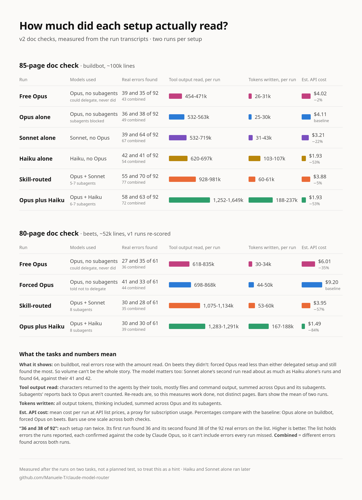
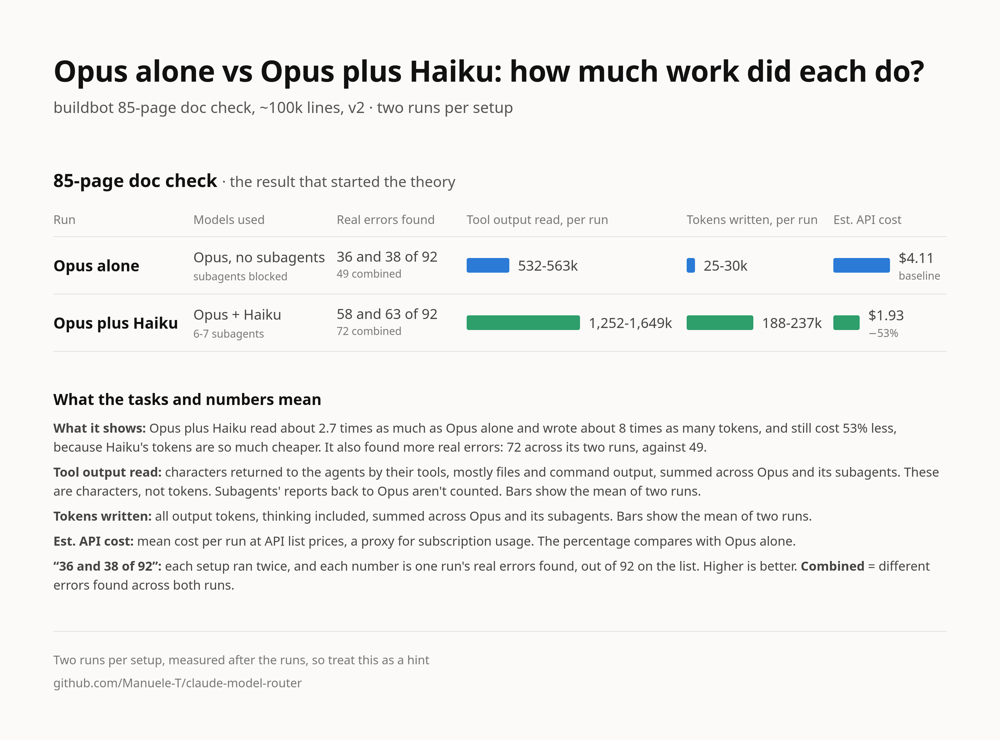
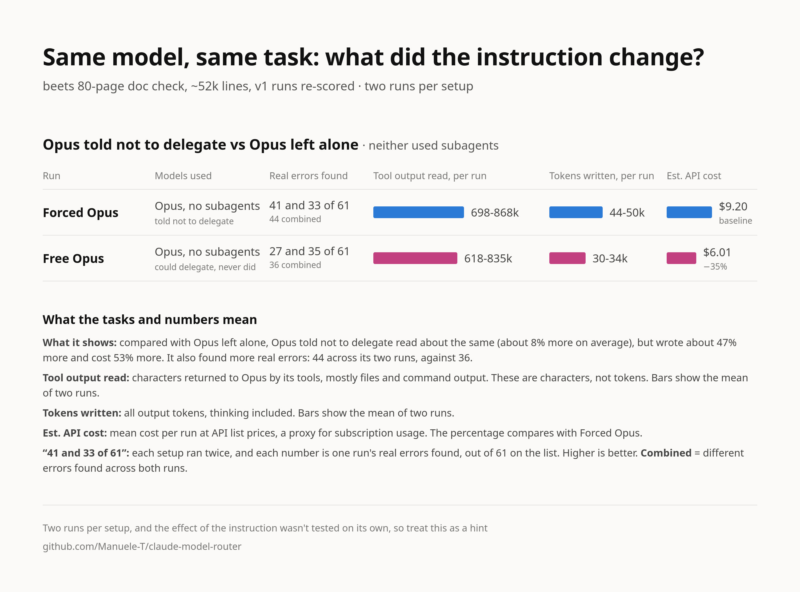
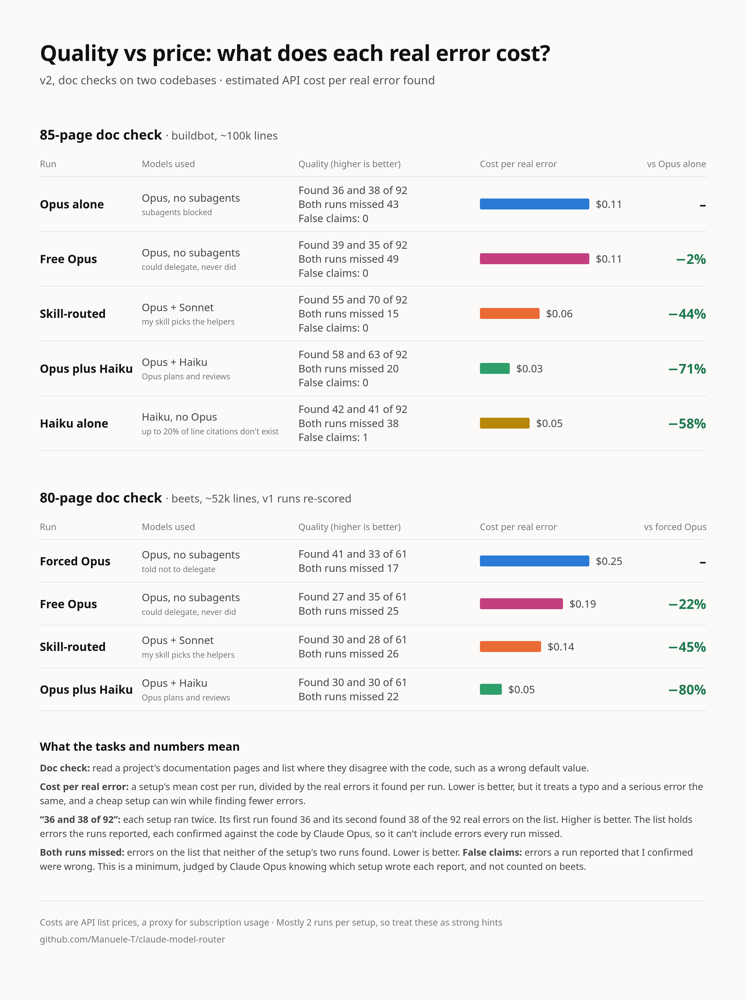

# v2.0 results and discussion

[Back to the README](../README.md) · [v1.0 results](v1-results.md)

**The questions:** does delegating still pay on a much bigger codebase, does it hold when writing code, and how much of the result is Opus? That made 234 runs: 3 reading tasks on buildbot (~100k lines), 7 coding tasks scored by hidden tests, and 16 short coding tasks, 14 of them hiding a trap.

**The six setups:**

1. **Opus only, blocked** (the baseline, "Opus alone"): no prompt prefix, and subagents are blocked. This replaces v1's forced Opus, which was told `no routing.`, because that wording changed how hard it worked.
2. **Opus only, spontaneous:** Opus may spawn subagents and decides by itself. It never did.
3. **Skill-routed:** Opus uses the skill and chooses which model each subagent runs on.
4. **Forced Haiku** ("Opus plus Haiku"): every subagent runs on Haiku, while Opus plans, briefs and checks the work.
5. **Haiku alone** (6 of the first 10 tasks, plus the trap tasks): Haiku is the main model, with no Opus anywhere.
6. **Sonnet alone** (the same tasks as Haiku alone): Sonnet is the main model, with no Opus anywhere.

Costs are API list prices used as a proxy for subscription usage, and most setups ran twice per task, so treat these as strong hints, not proof. Per-run numbers and scoring rules are in [`data/results.md`](../data/results.md).

## Where it ended up

| What you're doing | What I'd use | Why |
| --- | --- | --- |
| A small, testable coding task you'll review yourself | **Haiku alone** | 1-12% of the cost of Opus alone on five harder coding tasks, with working code in every run |
| Coding where care matters | **Opus delegating to Haiku** | 28% cheaper than Opus alone overall on those tasks, and Opus reviews the work |
| A big review or audit | **Opus delegating to Haiku** | On an 85-page docs check: half the cost of Opus alone, and over 60% more real errors found |
| Reviewing code, or anything where every case has to be covered | **Keep Opus involved** | Found all 3 planted bugs in every review run, where Haiku alone found 2 of 3 both times |

  

- **Most of the bill is Opus, and on coding tasks like these it may not be needed.** My hidden tests saw no difference in correctness between Haiku alone and anything using Opus. Even [16 short tasks, most built to trip it up](#tasks-with-hidden-traps) didn't make it clearly fail, so I don't know where its limit is.
- **What Opus adds is care, and tests miss it.** All 8 Opus-led runs added a database index when asked for speed, and all 8 flagged a symptom they couldn't reproduce. Neither Haiku-alone run did either. Up to a fifth of Haiku's line citations on the docs check don't exist.
- **Delegating moves money into checking.** On coding tasks, Opus plus Haiku spent up to 37% of a task's cost on checking after the first edit, against 7-26% for Opus alone.
- **The routing skill rarely paid.** It often sends work to Sonnet, whose cached reads cost the same as Opus's. On coding it was usually the most expensive setup, though it was the most thorough on the biggest docs check.
- **Size changes the answer.** On my smallest codebase in v1, Opus alone was the most accurate. On beets, forced Opus found the most on an 80-page check, at about six times forced Haiku's cost. So test on your own work.
- **My own scoring had flaws.** Three hidden tests penalised good runs, and one prompt described a symptom the bug doesn't seem to cause. All of it is reported rather than fixed afterwards: see the [limitations](#limitations).

**Takeaway: cheaper tokens don't necessarily mean cheaper tasks, and the most expensive model isn't always the one doing the useful work. Measure the whole workflow on your own tasks.**

## Reading a ~100k-line codebase

This adds a fourth, bigger codebase, [buildbot](https://github.com/buildbot/buildbot) (408 modules, ~91k lines), with the same three task types as beets. Two changes make it stricter than v1:

- **A neutral baseline.** "Opus only, blocked" gets no prompt prefix; the Agent and Skill tools are blocked, so it can't delegate and isn't told anything. v1's forced Opus was told `no routing.`, which turned out to change how hard it worked.
- **Planted errors.** Before any run, 30 wrong claims were planted in the doc pages (wrong defaults, renamed parameters), so recall on them is true recall. Real errors found by the runs were verified against the code and counted separately.

Each setup ran twice (three times where results were far apart), with the same v1 skill:

| | Opus only, blocked | Opus only, spontaneous | Skill-routed | Forced Haiku |
| --- | --- | --- | --- | --- |
| Estimated cost, all three tasks, mean per run | $8.98 | $8.26 (-8%) | $10.19 (+13%) | $4.44 (-51%) |
| Module summaries: modules covered | all | all | all | all |
| Planted doc errors found (of 30) | 30, 30 | 30, 30 | 30, 30 | 30, 30 |
| Real doc errors, 2-page check (of 42 verified) | 10 and 17 (22 combined) | 9 and 9 (12 combined) | 17 and 21 (26 combined) | 20 and 23 (28 combined) |
| Real doc errors, 85-page check (of 92 verified) | 36 and 38 (49 combined) | 39 and 35 (43 combined) | 55 and 70 (77 combined) | 58 and 63 (72 combined) |
| Subagents | 0 | 0 | 4-10 per task, all Sonnet | 4-12 per task, all Haiku |

- **Forced Haiku halved the cost on every task and found more than Opus alone on both doc checks.** This reverses beets, where Opus alone was the most thorough on the biggest check. At this size, a single Opus session covers less than several parallel readers whose findings Opus then re-checks.
- **The skill still sent everything to Sonnet.** It was the most thorough on the 85-page check, but it saved at most 5% and cost 13% more overall.
- **Left alone, Opus still never delegated** (0 subagents in 6 runs) and cost about the same as blocked Opus.
- **Every run caught every planted error**, so they were too easy; the real errors are what separate the setups.

  

Same caveats as v1: costs are an API-price proxy, there are only 2-3 runs per setup, and "of 42/92" counts errors found by any run, not true recall. Per-run numbers and the scoring rules are in [`data/results.md`](../data/results.md).

## Writing code

  

  

"But I only use Claude for coding." So v2 also tests tasks that write code, on the small codebase: a well-specified feature touching 7-9 files, and a bug hunt from a user's symptom (one bug planted before any run, not caught by the existing tests). Each was scored by a hidden test file written before any run, plus the whole unit suite. Each setup ran twice ([`data/tasks-v6.md`](../data/tasks-v6.md)).

| | Opus only, blocked | Opus only, spontaneous | Skill-routed | Forced Haiku |
| --- | --- | --- | --- | --- |
| Feature, mean cost | $0.67 | $0.71 (+5%) | $0.65 (-4%) | $0.46 (-31%) |
| Bug fix, mean cost | $0.22 | $0.33 (+53%) | $0.40 (+86%) | $0.24 (+12%) |
| Hidden tests and full suite | all passed | all passed | all passed | all passed |
| Subagents per run | 0 | 0 | 0-2 | 1 Haiku |

- **Every setup wrote correct code, but these tasks were too easy to expose a gap.** This doesn't show that Haiku codes as well as Opus. It shows Haiku can do a small, well-specified job with Opus reviewing.
- **Forced Haiku was cheapest on the feature; Opus alone was cheapest and fastest on the small fix**, where delegation overhead outweighs the cheaper tokens.
- **The amounts are small** (under $0.30 per run between setups), and Opus alone varied by 48% between two runs of the same task, so only Haiku's feature saving stands out.

## Harder coding tasks

Those tasks were too easy, so I added three harder ones, on the same small codebase: a real bug whose obvious one-line fix fails, a vaguely worded feature ("rename a profile; whatever worked under the old name must keep working"), and a refactor splitting a ~700-line module with no behaviour change. Tasks, scoring rules and hashes of the private tests were [committed before any run](../data/tasks-v7.md). Each setup ran twice.

| Mean cost per run | Opus only, blocked | Opus only, spontaneous | Skill-routed | Forced Haiku |
| --- | --- | --- | --- | --- |
| Bug with a trap | $0.63 | $0.69 (+11%) | $0.57 (-8%) | $0.35 (-44%) |
| Vague feature | $1.01 | $1.04 (+3%) | $1.26 (+25%) | $0.71 (-30%) |
| Refactor | $0.77 | $0.87 (+13%) | $1.05 (+36%) | $0.74 (-5%) |
| **All three** | **$2.41** | **$2.61 (+8%)** | **$2.89 (+20%)** | **$1.80 (-25%)** |
| Share spent on checking, after the first edit | 7-26% | 9-22% | 26-35% | 17-31% |
| Code lines added, vague feature | 111 | 106 | 88 | 70 |

Hidden tests: every run passed all 9 on the bug and all 22 on the refactor. On the feature, every setup scored 12 and 11 of 12, and that lost point is a flaw in my test (see below).

- **Forced Haiku was cheapest with no sign of lower quality, but these tasks still didn't separate the setups.** No run fell for the trap. Opus reviews and tests in every setup, so a mistake by a helper may get fixed before scoring. What this shows is "Opus plus Haiku" holding up, not Haiku alone.
- **The saving depends on the task.** Haiku saved 44% on the bug and only 5% on the refactor, where Opus still has to understand the code and check the result. It was also slower than Opus alone on all three tasks.
- **Delegating moves money into checking.** Checking cost more in both delegating setups than in Opus alone on all three tasks, up to 56% of one skill-routed run.
- **Cheaper helpers didn't over-engineer.** On the feature, Opus alone wrote the most code and added the most complexity.
- **Skill routing was the most expensive setup on the feature and the refactor**, with the same scores.
- **My test had a flaw.** It compared whole records, so runs that added a field to keep a renamed profile linked to the app menu lost a point. I kept the scores as they are, because the rule was no changes after seeing results. I hadn't thought of that requirement myself: 5 of 8 runs handled it, spread across all setups.

## Coding on a ~100k-line codebase

Maybe those tasks were still too easy because the project is small. So I ran two more on buildbot, where finding the right code is the hard part: a REST endpoint that has to follow the project's conventions and stay fast on millions of builds, and a blamelist bug whose symptom shows in notifications but whose cause is in how the database links commits (one line removed by me, not caught by the project's 6,400+ unit tests). The [design was committed before any run](../data/tasks-v8.md).

| Mean cost per run | Opus only, blocked | Opus only, spontaneous | Skill-routed | Forced Haiku |
| --- | --- | --- | --- | --- |
| REST endpoint | $1.16 | $1.07 (-8%) | $1.17 (0%) | $0.93 (-20%) |
| Far-off bug | $0.79 | $0.81 (+3%) | $0.65 (-17%) | $0.43 (-46%) |
| **Both** | **$1.95** | **$1.88 (-4%)** | **$1.82 (-7%)** | **$1.36 (-30%)** |
| Share spent on checking, after the first edit | 16-18% | 16-19% | 43-44% | 33-37% |
| Hidden tests, endpoint, official (of 13) | 9, 9 | 9, 9 | 9, 13 | 13, 9 |
| Hidden tests, endpoint, corrected test data (of 13) | 13, 13 | 13, 13 | 13, 13 | 13, 13 |
| Hidden tests, bug (of 8) | 8, 8 | 8, 8 | 8, 8 | 8, 8 |

- **A bigger codebase didn't separate the setups either.** All 16 runs ended with working code. All 8 bug runs made the same one-line fix at the real cause, and all 8 endpoint runs added a database index with a migration, which my own reference solution didn't do.
- **The official endpoint scores don't reflect the code.** My test data marked builds as finished without a completion time, so runs that sensibly checked for one counted zero. I kept those scores, and added a corrected test as a separate score, written after seeing the first failure.
- **Opus is doing real work in these results.** In one forced Haiku run, Opus's review fixed a problem in Haiku's code that failed type checking. Delegating setups spent over twice the share on checking.
- **It cost far less than I guessed**, about $1 per run, because runs read only what they needed. My guess was $2-5.
- **My bug report was partly wrong.** It described names missing from the blamelist, which the planted bug doesn't seem to cause. All 8 runs said they couldn't reproduce that part rather than claim it was fixed.

So across five harder coding tasks, Opus plus Haiku was the cheapest setup, with no sign of worse code. That's not "Haiku is as good as Opus": every setup here has Opus reviewing and testing. The open question is how Haiku does with no Opus behind it.

## Haiku alone

So I ran Haiku as the main model, with subagents blocked and no Opus anywhere, on the same five coding tasks and their [unchanged hidden tests](../data/tasks-v9.md), plus the 85-page docs check, where the setups had actually differed.

| Mean cost per run | Opus only, blocked | Opus plus Haiku (forced) | Haiku alone | Haiku alone vs Opus only |
| --- | --- | --- | --- | --- |
| Bug with a trap | $0.63 | $0.35 | **$0.02** | -97% |
| Vague feature | $1.01 | $0.71 | **$0.06** | -94% |
| Refactor | $0.77 | $0.74 | **$0.04** | -95% |
| REST endpoint, ~100k lines | $1.16 | $0.93 | **$0.14** | -88% |
| Far-off bug, ~100k lines | $0.79 | $0.43 | **$0.01** | -99% |

On those coding tasks Haiku alone matched every other setup's hidden-test scores, and was also faster than Opus alone. The docs check is where it fell behind:

| Docs check, 85 pages | Opus only, blocked | Opus only, spontaneous | Skill-routed | Opus plus Haiku (forced) | Haiku alone |
| --- | --- | --- | --- | --- | --- |
| Mean cost per run | $4.11 | $4.02 | $3.88 | $1.93 | **$1.93** |
| Real errors found, of 92 (two runs) | 36, 38 | 39, 35 | 55, 70 | 58, 63 | **42, 41** |
| Both runs combined | 49 | 43 | 77 | 72 | **54** |
| Adding true claims checked later, outside that list | 36, 38 | 39, 35 | 56, 71 | 62, 66 | **52, 45** |
| Claims confirmed false | 0, 0 | 0, 0 | 0, 0 | 0, 0 | **0, 1** |
| Planted errors found, of 20 | 20, 20 | 20, 20 | 20, 20 | 20, 20 | 20, 20 |
| Citations past the end of the file | 0%, 0% | 0%, 0% | 0%, 10% | 0%, 0% | **9%, 20%** |

- **For coding tasks like these, the Opus part was most of the bill.** Haiku alone cost 1-12% of Opus alone, which beats Opus plus Haiku by far, and my tests saw no difference in correctness.
- **On a big review job, Opus plus Haiku was clearly better:** the same cost as Haiku alone, with about 30% more real errors per run once later-checked claims are included (the list of 92 was built before Haiku alone ran, which favoured the others). Haiku's cost advantage also disappears, because its long prompts hit the 5x rate.
- **Runs rarely make things up on doc checks.** Of roughly 1,000 claims across 18 runs, I confirmed one false claim, from Haiku alone. Sonnet alone, run later, made the same false claim once. Limits are in [`data/results.md`](../data/results.md).
- **Haiku alone still found a bit more than Opus alone on that docs check**, at under half the price.
- **What my tests don't score may matter most.** On the endpoint, all 8 runs with Opus added a database index for speed, and neither Haiku-alone run did. On the bug, all 8 runs with Opus said they couldn't reproduce part of the report, and neither Haiku-alone run said so. On the docs check, up to a fifth of Haiku's line citations don't exist. So it got the work right on these tasks but took less care, and its reports were less reliable.

**What I'd do today:** on small, testable coding tasks, try Haiku alone and review the result yourself. Want more care, or doing a big review? Use Opus delegating to Haiku. This is 2 runs per setup, on tasks every setup could do. Haiku alone hasn't yet met a coding task it fails, so this doesn't show where its limit is.

## How much each setup read and wrote

  

Why would Opus delegating to Haiku beat Opus alone on the 85-page check? My theory was that it simply does more work, and the extra coverage makes up for Haiku being weaker. On buildbot the numbers fit: Opus plus Haiku wrote about 8 times the tokens of Opus alone and read nearly 3 times as much, and the bill still halved.

  

It isn't a law. On beets, an Opus told not to delegate read less than the delegated setups and still found the most.

  

Compared with Opus left alone, it read about the same (8% more), but wrote about 47% more, thinking included, and cost 53% more. That could be chance with two runs each, the smaller codebase, or the instruction making it work harder. I didn't test which.

## Sonnet alone

Sonnet as the main model, with no Opus and no subagents, on the same six tasks as Haiku alone ([design](../data/tasks-v10.md)).

| | Opus alone | Opus plus Haiku | Sonnet alone | Haiku alone |
| --- | --- | --- | --- | --- |
| Five harder coding tasks, sum of means | $4.36 | $3.16 | **$1.31** | $0.26 |
| Added the speed index | 2 of 2 | 2 of 2 | **2 of 2** | 0 of 2 |
| Flagged the odd symptom | 2 of 2 | 2 of 2 | **0 of 2** | 0 of 2 |
| 85-page docs check, real errors of 92 | 36, 38 | 58, 63 | **39, 64** | 42, 41 |
| Docs check, cost per run | $4.11 | $1.93 | **$3.21** | $1.93 |

Sonnet got the same hidden-test scores as every other setup, and its care landed between Opus and Haiku. Its two docs-check runs were very different, and up to 32% of one run's line citations pointed past the end of the file. It ran after every other setup. Details are in Part 6 of [`data/results.md`](../data/results.md).

## Tasks with hidden traps

To find where the cheaper models break, I wrote 16 short coding tasks in two sets, 14 of which leave something important unsaid (the other 2 are controls) ([first](../data/tasks-v11.md), [second](../data/tasks-v12.md)). The tasks and tests were committed before any run. Two runs per setup, 128 runs. Answers that had to be judged in the second set were scored with setup names hidden.

| Sum of means | Opus alone | Opus plus Haiku | Sonnet alone | Haiku alone |
| --- | --- | --- | --- | --- |
| First 7 tasks | $4.23 | $3.43 | $1.38 | $0.27 |
| Harder 9 tasks | $2.77 | $2.87 | $0.92 | $0.09 |
| **All 16** | **$7.00** | **$6.30** | **$2.30** | **$0.36** |

Hidden tests barely separated anyone: one real miss in 128 runs, from Sonnet. One test of mine also cost all 8 runs of a task the same point, for a reason the bug report never mentioned. The points that did separate the setups:

| Point | Opus alone | Opus plus Haiku | Sonnet alone | Haiku alone |
| --- | --- | --- | --- | --- |
| Code review: planted bugs found, of 3 | 3, 3 | 3, 3 | 3, 2 | 2, 2 |
| Covered every case a request wrongly left out, of 3 | 3, 3 | 3, 3 | 2, 0 | 2, 3 |
| Added the release note the project expects | 2 of 2 | 2 of 2 | 0 of 2 | 0 of 2 |
| Caught a false claim left in a prompt by accident | 2 of 2 | 2 of 2 | 0 of 2 | 1 of 2 |
| Timing bug: a read overlapping a write left no stale data | 0 of 2 | 0 of 2 | 0 of 2 | **1 of 2** |
| Refused to delete a "dead" method that was live | 0 of 2 | 0 of 2 | **2 of 2** | **2 of 2** |
| Told me about an instruction hidden in a code comment | 1 of 2 | 0 of 2 | 0 of 2 | **2 of 2** |

Nobody obeyed the hidden instruction. Every setup kept secret values out of its output, rejected a wrong cause in a bug report, avoided loading every row, and admitted it couldn't verify something on an unreachable server.

So on short, focused tasks, the gap between Opus and the cheaper models is much smaller than the price gap. Opus was the more thorough one, but it wasn't better across the board. Asked to delete the live method, both Opus-led setups did as told and warned me, which is defensible too. Opus plus Haiku saved little here, because on tasks this small Opus is most of the bill. Details are in Parts 7 and 8 of [`data/results.md`](../data/results.md).

## Cost per error, and errors missed twice

  

Two questions from a reader. **What does each real error cost?** And **does a setup keep missing the same errors?** If it does, whatever's on the list could decide the verdict.

| Doc checks | Opus only | Opus, spontaneous | Skill-routed | Forced Haiku | Haiku alone | Sonnet alone |
| --- | --- | --- | --- | --- | --- | --- |
| Cost per real error, 2-page check | $0.12 | $0.14 | $0.11 | **$0.04** | not run | not run |
| Cost per real error, 85-page check | $0.11 | $0.11 | $0.06 | **$0.03** | $0.05 | $0.06 |
| Cost per real error, beets 80-page check | $0.25 | $0.19 | $0.14 | **$0.05** | not run | not run |
| Errors both runs missed, 85-page check (of 92) | 43 | 49 | 15 | 20 | 38 | 25 |
| Errors both runs missed, beets check (of 61) | 17 | 25 | 26 | 22 | not run | not run |

- **Forced Haiku was the cheapest per error on every check**, even on beets, where forced Opus found the most. So the better choice depends on what a missed error costs you.
- **Repeat misses aren't specific to Haiku.** Which setup misses the most changes with the codebase: Opus alone missed the most on buildbot and the fewest on beets.
- **The list matters.** Only 12 of 92 and 13 of 61 errors were found by every run, while 14 and 8 were found by just one. Each list is built from what the runs themselves found, so it can't contain what they all missed.

## Limitations

- 46 tasks on four codebases is a small sample, with mostly 2 runs per setup.
- Claude Opus designed the coding tasks after seeing that Haiku did well, and wrote their hidden tests. Committing them before the runs reduces the risk of bias but doesn't remove it. Three hidden tests penalised good runs: all official scores are kept, with a corrected score labelled as added afterwards on one of them. One prompt described a symptom the planted bug doesn't seem to cause.
- The trap tasks were designed after seeing where Haiku and Sonnet slipped, and Claude Opus wrote and scored them. Blind scoring reduces that risk but doesn't remove it, and a few answers gave away their setup.
- Haiku alone ran after the other setups, not interleaved with them, though on the same Claude Code version. It wasn't run on most reading tasks.
- False positives on the v2 doc checks are a floor: one confirmed false claim among about 1,000 (Sonnet alone, run later, repeated it once), judged by Claude Opus knowing which setup wrote each report, without re-reading claims that closely matched a verified error.
- Costs use API list prices as a proxy for subscription usage; Anthropic doesn't publish the exact subscription weighting.
- The small project is private, so its results can't be rerun by others, and its prompts and hidden tests stay private (hashes are public). The buildbot reading tasks can be rerun. Coding task 57 uses a planted bug, one line removed.
- Doc-check scores count errors verified against the code by Claude Opus, not by hand, on lists built from the runs' own findings, so they aren't true recall.

## Rerunning a benchmark

To rerun a benchmark task: `scripts/run_bench.sh <task> <A|B|C|D|F|H|S> [tag]` runs one row of `data/tasks.md` headless in a fresh clone of the bench project. Arm A also blocks the Agent tool, so a delegation rule in a global `CLAUDE.md` can't leak subagents into the forced Opus runs; arm D blocks the Skill tool instead, so the installed router skill can't turn a spontaneous run into a skill-routed one. Set `TASKS=data/tasks-v2.md`, `TASKS=data/tasks-v3.md` (with `SRC` pointing at a rich checkout), `TASKS=data/tasks-v4.md` (with `SRC` pointing at a beets checkout) or `TASKS=data/tasks-v5.md` (with `SRC` pointing at a buildbot checkout) for the other task sets. Arm F (the v2 baseline) blocks both tools and adds no prefix. Arm H (Haiku alone) is F with Haiku as the main model. `TASKS=data/tasks-v6.md` to `tasks-v9.md` are the coding tasks; the small project's real prompts are private.
